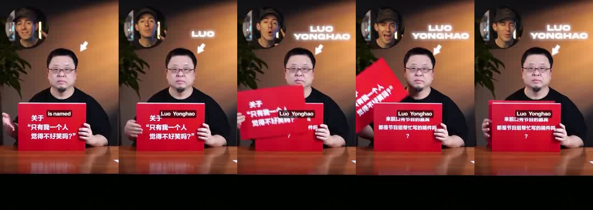

# v15_s16 · pip_broll · 16.5–17.8s (calidad 4)

- **Guion:** is named Luo Yonghao.
- **Qué se ve:** Retrato a pantalla completa del presentador con gafas sosteniendo un cartel rojo, fondo naranja; flecha blanca pequeña, rótulo «LUO YONGHAO» en sans extendida blanca arriba a la derecha (desde ~17,0 s) y su cara en círculo arriba-izquierda. Subtítulo con el nombre «Luo Yonghao» en caja oscura. Barra negra bajo la imagen.
- **Diseño:** Grabación vertical del directo a pantalla completa con su cara en un círculo arriba a la izquierda: diámetro ~255 px (35 % del ancho), centro en x≈160, y≈165 px, sin borde. Subtítulo: sans bold blanca (tipo Inter/Helvetica Now Bold) ~30 px de alto de fuente sobre 720 px de ancho, 1–3 palabras, centrado en x, sombra negra suave. Subtítulo en y≈693 px con caja oscura semitransparente.
- **Efectos:** Sin texturas; flecha blanca gruesa dibujada con sombra.
- **Animación:** La flecha entra con pop/escala (~4 fotogramas) apuntando al sujeto; corte seco.
- **Por qué aquí:** Presenta al personaje con nombre en pantalla (difícil de entender de oído).
