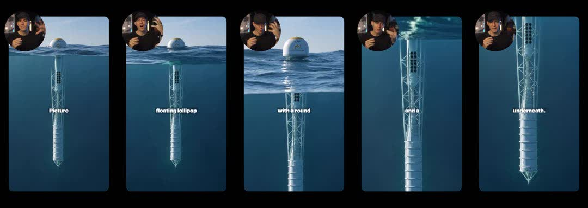

# v16_s20 · pip_broll · 34.0–39.6s (calidad 5)

- **Guion:** Picture a giant floating lollipop in the sea with a round buoy on top and a long tube underneath.
- **Qué se ve:** Tarjeta con render 3D: boya blanca en la superficie y un tubo/celosía larguísimo bajo el agua azul; su cara en un círculo arriba-izquierda. La cámara se acerca a la boya y baja por el tubo. Subtítulos «Picture», «a giant», «floating lollipop», «in the sea,», «with a round», «buoy on top», «long tube», «underneath.».
- **Diseño:** Pantalla completa NEGRA con el material dentro de una tarjeta vertical de esquinas redondeadas (~24 px de radio): x≈54–666 px (85 % del ancho), y≈103–1176 px (84 % del alto). Subtítulo: sans bold blanca (tipo Inter/Helvetica Now Bold) ~30 px de alto de fuente sobre 720 px de ancho, 1–3 palabras, centrado en x, sombra negra suave. Subtítulo en y≈680 px (53 %), sobre la tarjeta, con sombra. Su cara en un círculo arriba a la izquierda que pisa la esquina de la tarjeta: diámetro ~250 px (35 % del ancho), centro ≈(150, 190) px, sin borde.
- **Efectos:** Render 3D de agua azul con cáusticas; fondo negro.
- **Animación:** Cámara virtual: push-in lento hacia la boya y luego descenso por el tubo (5,6 s); el círculo queda fijo. Corte seco.
- **Por qué aquí:** Metáfora del «chupachups gigante»: una sola toma larga para entender la forma; el PiP mantiene al narrador.
