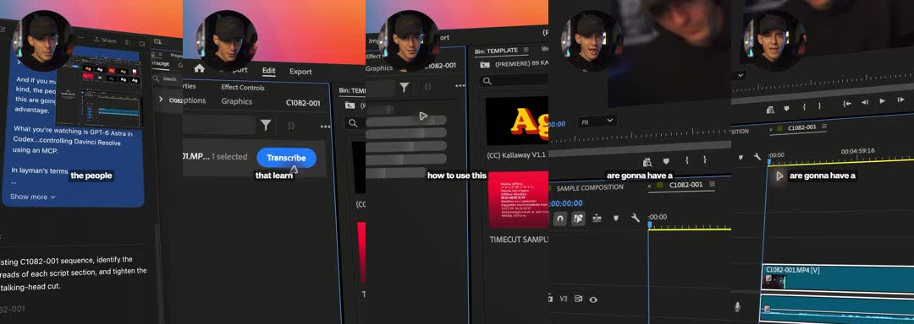

# v17_s04 · pip_broll · 6.3–8.3s (calidad 4)

- **Guion:** the people that learn how to use this are gonna have a
- **Qué se ve:** Grabación de pantalla a pantalla completa (app con panel azul de chat y luego interfaz de edición: pestañas Edit/Export, botón azul «Transcribe», «C1082-001», timeline «SAMPLE COMPOSITION») con su cara en un círculo arriba-izquierda. Subtítulos «the people / that learn / how to use this / are gonna have a» en el centro.
- **Diseño:** Grabación de pantalla a sangre completa (100 %), inclinada en 3D con fondo degradado naranja-rosa arriba; su cara en círculo de ≈150 px de diámetro arriba-izquierda (centro x≈20 %, y≈7 %); subtítulo pequeño blanco sin caja en y≈54 %.
- **Efectos:** Tarjeta con esquinas redondeadas sobre negro puro; cajita del subtítulo ≈#2A2A2A al ~70 %; sin grano.
- **Animación:** Corte seco de entrada (6.34) y salida (8.30); dentro, movimiento de cámara virtual continuo (pan + zoom ~1.5x) sobre la UI durante los 2 s; subtítulo por pop seco.
- **Por qué aquí:** «the people that learn how to use this»: enseña la herramienta por dentro mientras mantiene su cara pequeña; cambia el layout a los 6 s para resetear la atención.
