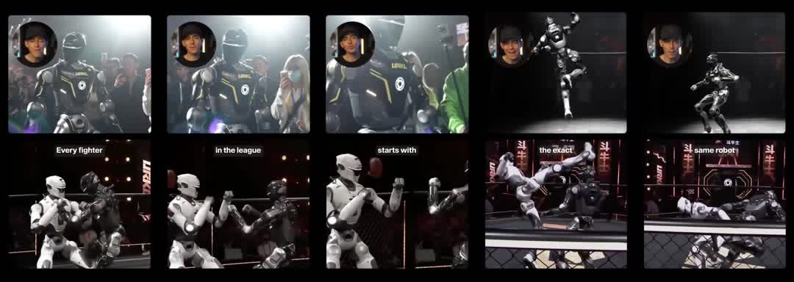

# v18_s07 · pip_broll · 13.6–16.6s (calidad 5)

- **Guion:** Every fighter in the league starts with the exact same robot.
- **Qué se ve:** Fondo negro con DOS tarjetas apiladas: arriba robot negro entrando entre público con móviles (con su cara en círculo arriba-izq.), abajo robots boxeando en el ring; a los 15.3 s ambas cambian (robot dando patada voladora / robot derribado). Subtítulo en cajita entre las dos tarjetas: «Every fighter / in the league / starts with / the exact / same robot».
- **Diseño:** Fondo negro; DOS tarjetas apaisadas apiladas (cada una ≈90 % del ancho × 42 % del alto, radio ~10 px), círculo de su cara ≈210 px arriba-izquierda sobre la primera; subtítulo blanco pequeño con cajita gris oscuro justo en el hueco entre tarjetas (y≈53 %).
- **Efectos:** Tarjeta con esquinas redondeadas sobre negro puro; cajita del subtítulo ≈#2A2A2A al ~70 %; sin grano.
- **Animación:** Corte seco de entrada y salida; dentro, cortes secos entre clips a palabra; el círculo queda fijo (él sigue hablando dentro).
- **Por qué aquí:** «Every fighter… same robot»: dos robots/dos clips a la vez = comparación visual de «todos iguales».
