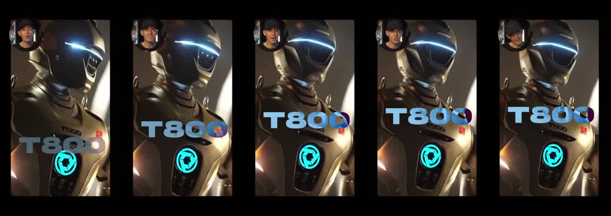

# v18_s09 · pip_broll · 18.0–19.2s (calidad 5)

- **Guion:** the T-800.
- **Qué se ve:** Tarjeta vertical: robot dorado/oscuro con visor azul; rótulo grande «T800» en azul degradado que entra encima. Subtítulo «called the T-800».
- **Diseño:** Fondo negro; b-roll en tarjeta vertical de esquinas redondeadas (≈86 % del ancho × 88 % del alto, radio ~12 px, márgenes ~50 px) y su cara en un círculo de ≈210–230 px de diámetro (≈30 % del ancho) arriba-izquierda, montado sobre la esquina de la tarjeta. Subtítulo pequeño blanco en el centro (y≈54 %) dentro de una cajita gris oscuro semitransparente redondeada.
- **Efectos:** Tarjeta con esquinas redondeadas sobre negro puro; cajita del subtítulo ≈#2A2A2A al ~70 %; sin grano.
- **Animación:** Corte seco de entrada y salida; dentro, cortes secos entre clips a palabra; el círculo queda fijo (él sigue hablando dentro). Rótulo T800: entra desde abajo con fade (≈6 fotogramas) y queda fijo.
- **Por qué aquí:** Nombre del modelo → rótulo gigante con el nombre: «nombre propio = texto en pantalla».
