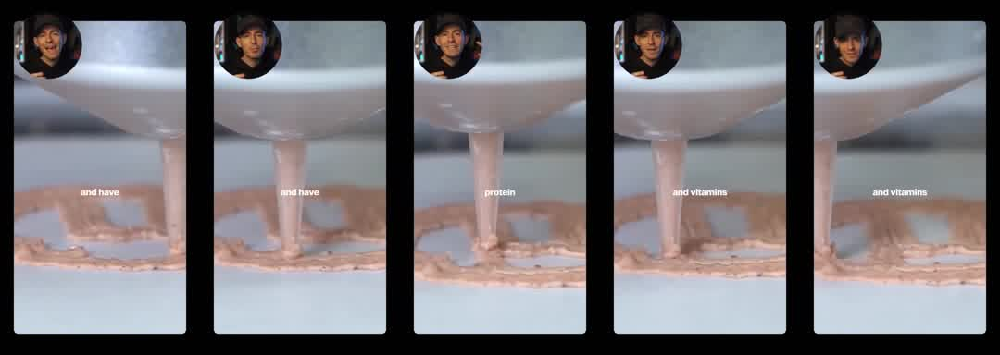

# v19_s04 · pip_broll · 6.2–8.1s (calidad 3)

- **Guion:** have protein and vitamins that
- **Qué se ve:** Tarjeta: boquilla de impresora 3D extruyendo pasta rosada sobre una superficie blanca formando el aro. Subtítulos «and have / protein / and vitamins».
- **Diseño:** Fondo negro; b-roll en tarjeta vertical de esquinas redondeadas (≈86 % del ancho × 88 % del alto, radio ~12 px, márgenes ~50 px) y su cara en un círculo de ≈210–230 px de diámetro (≈30 % del ancho) arriba-izquierda, montado sobre la esquina de la tarjeta. Subtítulo pequeño blanco en el centro (y≈54 %) dentro de una cajita gris oscuro semitransparente redondeada.
- **Efectos:** Tarjeta con esquinas redondeadas sobre negro puro; cajita del subtítulo ≈#2A2A2A al ~70 %; sin grano.
- **Animación:** Corte seco de entrada y salida; dentro, cortes secos entre clips a palabra; el círculo queda fijo (él sigue hablando dentro).
- **Por qué aquí:** «protein and vitamins» → la pasta de la que está hecha.
