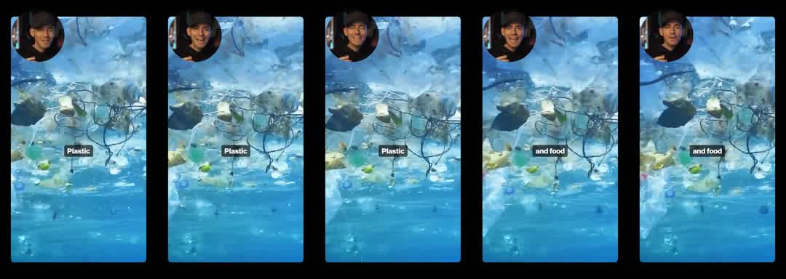

# v19_s13 · pip_broll · 22.1–23.0s (calidad 3)

- **Guion:** Plastic and food
- **Qué se ve:** Tarjeta vertical: plástico flotando bajo el agua del mar; su cara en círculo. Subtítulo con cajita «Plastic».
- **Diseño:** Fondo negro; b-roll en tarjeta vertical de esquinas redondeadas (≈86 % del ancho × 88 % del alto, radio ~12 px, márgenes ~50 px) y su cara en un círculo de ≈210–230 px de diámetro (≈30 % del ancho) arriba-izquierda, montado sobre la esquina de la tarjeta. Subtítulo pequeño blanco en el centro (y≈54 %) dentro de una cajita gris oscuro semitransparente redondeada.
- **Efectos:** Tarjeta con esquinas redondeadas sobre negro puro; cajita del subtítulo ≈#2A2A2A al ~70 %; sin grano.
- **Animación:** Corte seco de entrada y salida; dentro, cortes secos entre clips a palabra; el círculo queda fijo (él sigue hablando dentro).
- **Por qué aquí:** «Plastic» → una palabra, un plano.
