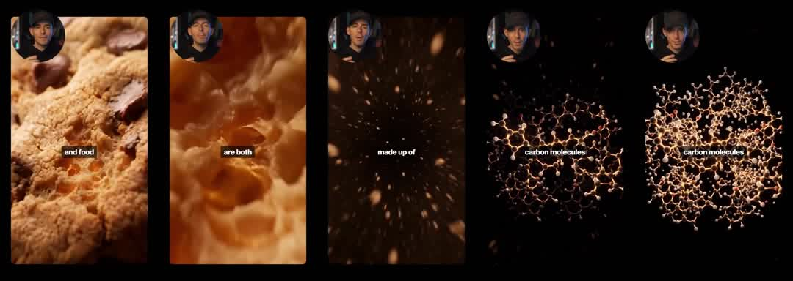

# v19_s14 · pip_broll · 23.0–26.1s (calidad 5)

- **Guion:** are both made up of carbon molecules.
- **Qué se ve:** Tarjeta: macro de una galleta con chocolate en la que la cámara entra hasta la miga; la miga se vuelve chispas naranjas sobre negro y estas se ordenan en una red de moléculas de carbono brillantes. Subtítulos «and food / are both / made up of / carbon molecules».
- **Diseño:** Fondo negro; b-roll en tarjeta vertical de esquinas redondeadas (≈86 % del ancho × 88 % del alto, radio ~12 px, márgenes ~50 px) y su cara en un círculo de ≈210–230 px de diámetro (≈30 % del ancho) arriba-izquierda, montado sobre la esquina de la tarjeta. Subtítulo pequeño blanco en el centro (y≈54 %) dentro de una cajita gris oscuro semitransparente redondeada.
- **Efectos:** Tarjeta con esquinas redondeadas sobre negro puro; cajita del subtítulo ≈#2A2A2A al ~70 %; sin grano.
- **Animación:** Corte seco de entrada y salida; dentro, zoom-in continuo de ≈3 s con morph (galleta → chispas → moléculas), probablemente clip generado; círculo fijo.
- **Por qué aquí:** «both made up of carbon molecules» → un solo zoom que une comida y molécula: explica la idea científica con una transición-metáfora.
