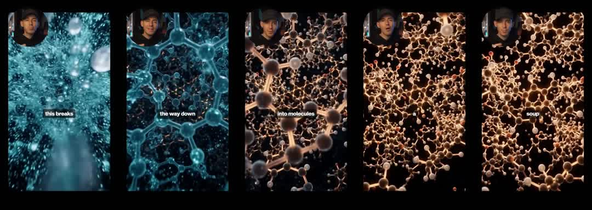

# v19_s17 · pip_broll · 31.5–35.6s (calidad 4)

- **Guion:** And this breaks them all the way down into molecules, basically a carbon soup.
- **Qué se ve:** Tarjeta: gráfico de partículas turquesa que se ordenan en una red molecular azul y luego viran a moléculas ámbar sobre negro. Subtítulos «this breaks / all / the way down / into molecules / Basically / carbon / soup».
- **Diseño:** Fondo negro; b-roll en tarjeta vertical de esquinas redondeadas (≈86 % del ancho × 88 % del alto, radio ~12 px, márgenes ~50 px) y su cara en un círculo de ≈210–230 px de diámetro (≈30 % del ancho) arriba-izquierda, montado sobre la esquina de la tarjeta. Subtítulo pequeño blanco en el centro (y≈54 %) dentro de una cajita gris oscuro semitransparente redondeada.
- **Efectos:** Tarjeta con esquinas redondeadas sobre negro puro; cajita del subtítulo ≈#2A2A2A al ~70 %; sin grano.
- **Animación:** Corte seco de entrada y salida; dentro, cortes secos entre clips a palabra; el círculo queda fijo (él sigue hablando dentro). Cadencia entrecortada tipo stop-motion: 19 saltos detectados a intervalos de 0.2085 s entre 31.49 y 35.24.
- **Por qué aquí:** «breaks them down into molecules… carbon soup» → animación molecular: el paso invisible se hace visible.
