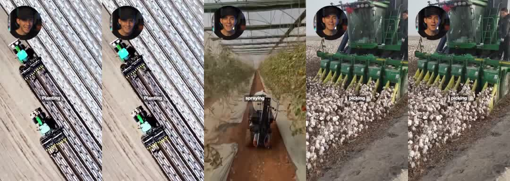

# v20_s14 · pip_broll · 25.6–27.6s (calidad 5)

- **Guion:** Planting, spraying, picking, about
- **Qué se ve:** Video a pantalla completa (sin tarjeta) con su cara en círculo arriba-izq.: tractores sembrando en vista cenital, robot pulverizador en un invernadero y cosechadora verde recogiendo algodón. Un subtítulo por plano: «Planting» / «spraying» / «picking».
- **Diseño:** B-roll a SANGRE COMPLETA (9:16, sin tarjeta ni márgenes negros); su cara en círculo ≈150–160 px arriba-izquierda (centro x≈21 %, y≈7 %); subtítulo blanco pequeño de 1 palabra en y≈54 % (cajita gris tenue).
- **Efectos:** Tarjeta con esquinas redondeadas sobre negro puro; cajita del subtítulo ≈#2A2A2A al ~70 %; sin grano.
- **Animación:** Cortes secos exactamente en cada palabra (25.65 / 26.28 / 26.99); cada plano dura 0.63–0.71 s; círculo fijo.
- **Por qué aquí:** Enumeración de 3 palabras → 3 planos de 0.6–0.7 s, uno por palabra, a pantalla completa: demuestra «todo lo demás ya está automatizado».
