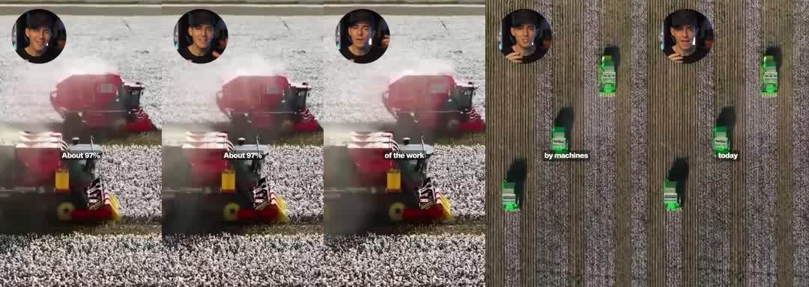

# v20_s15 · pip_broll · 27.6–30.6s (calidad 3)

- **Guion:** 97% of the work is done by machines today.
- **Qué se ve:** Video a pantalla completa con círculo: cosechadora roja levantando polvo en un campo blanco de algodón y luego vista cenital de tres cosechadoras verdes. Subtítulos «About 97% / of the work / by machines / today».
- **Diseño:** B-roll a sangre completa con círculo de su cara arriba-izquierda (≈150–160 px) y subtítulo pequeño en y≈54 %.
- **Efectos:** Tarjeta con esquinas redondeadas sobre negro puro; cajita del subtítulo ≈#2A2A2A al ~70 %; sin grano.
- **Animación:** Corte seco de entrada/salida y un corte interno a 29.32 («done by machines»).
- **Por qué aquí:** Estadística (97 %) sostenida con maquinaria a gran escala.
