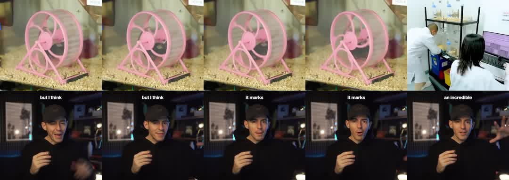

# v01_s33 · split_broll · 60.2–61.1s (calidad 2)

- **Guion:** but I think it marks an
- **Qué se ve:** Arriba: rueda rosa en la jaula. Subtítulo 'but I think' / 'it marks'.
- **Diseño:** Pantalla dividida 50/50, costura recta en y=50 % sin línea ni sombra. Arriba video real recortado a 720×640 (9:8). Abajo él en plano medio (cabeza en y≈60–68 % del cuadro total). Subtítulo blanco, sans geométrica bold en minúsculas/caja normal (tipo Gilroy/Satoshi; fuente exacta desconocida), 1–3 palabras, centrado en x=50 %, centro en y≈54 % (≈692 px de 1280), altura de minúscula+ascendente ≈22 px (≈1.7 % del alto), sombra suave oscura.
- **Efectos:** Sin texturas. Contraste claro/oscuro: laboratorio blanco arriba contra set negro abajo.
- **Animación:** Corte seco arriba; el A-roll de abajo sigue continuo. Subtítulo por sustitución seca.
- **Por qué aquí:** Reutiliza b-roll ya visto como relleno rápido.
