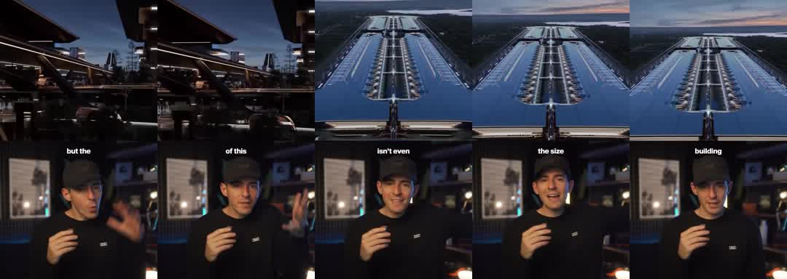

# v05_s12 · split_broll · 18.4–21.7s (calidad 3)

- **Guion:** But the wildest part of this project isn't even the size of the building. It's
- **Qué se ve:** Pantalla dividida. Arriba: render nocturno de una estructura/estación (18.39–19.94) y render aéreo del TeraFab (19.94–21.69).
- **Diseño:** Subtítulo blanco sans bold (tipo Inter/Helvetica Now), minúsculas con mayúscula inicial, 1–3 palabras, ~28 px sobre 720 (≈2,2 % del alto), centrado en x, y≈54 % (justo bajo la costura, que está en y≈50,4 %); sin caja sobre el A-roll oscuro
- **Efectos:** Set oscuro con luces prácticas cian y ámbar desenfocadas; sin textura añadida visible
- **Animación:** Corte seco de entrada y salida (1 fotograma)
- **Por qué aquí:** Transición de guion («But the wildest part…»): vuelve a la base dividida con imágenes neutras del edificio mientras plantea el giro
