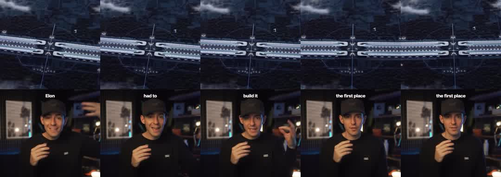

# v05_s14 · split_broll · 23.6–25.8s (calidad 2)

- **Guion:** had to build it in the first place.
- **Qué se ve:** Arriba: vista cenital nocturna del complejo entre nubes, con retícula/HUD tenue.
- **Diseño:** Subtítulo blanco sans bold (tipo Inter/Helvetica Now), minúsculas con mayúscula inicial, 1–3 palabras, ~28 px sobre 720 (≈2,2 % del alto), centrado en x, y≈54 % (justo bajo la costura, que está en y≈50,4 %); sin caja sobre el A-roll oscuro
- **Efectos:** Set oscuro con luces prácticas cian y ámbar desenfocadas; sin textura añadida visible
- **Animación:** Corte seco de entrada y salida (1 fotograma)
- **Por qué aquí:** Relleno visual mientras termina la frase de planteamiento; reutiliza un plano del hook
