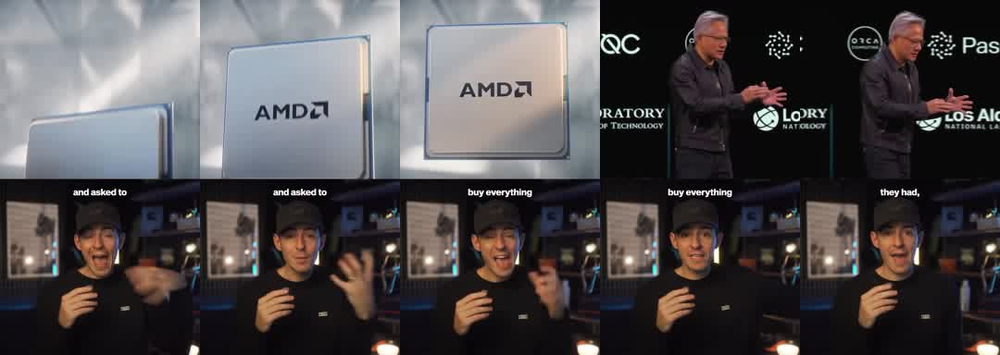

# v05_s16 · split_broll · 28.0–30.0s (calidad 3)

- **Guion:** asked to buy everything they had.
- **Qué se ve:** Arriba: chip AMD en 3D subiendo (27.99–29.07) y Jensen Huang en un escenario con logos (29.07–30.03).
- **Diseño:** Subtítulo blanco sans bold (tipo Inter/Helvetica Now), minúsculas con mayúscula inicial, 1–3 palabras, ~28 px sobre 720 (≈2,2 % del alto), centrado en x, y≈54 % (justo bajo la costura, que está en y≈50,4 %); sin caja sobre el A-roll oscuro
- **Efectos:** Set oscuro con luces prácticas cian y ámbar desenfocadas; sin textura añadida visible
- **Animación:** Corte seco de entrada y salida (1 fotograma); el chip AMD sube dentro del plano
- **Por qué aquí:** «Chip companies» → se muestran dos (AMD, Nvidia vía su CEO): evidencia de quiénes son
