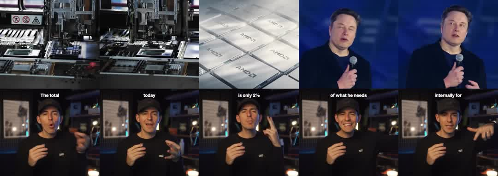

# v05_s18 · split_broll · 32.2–36.8s (calidad 3)

- **Guion:** the total chip supply today is only 2 % of what he needs internally for
- **Qué se ve:** Arriba: maquinaria de fábrica de chips (32.16–33.66), chips AMD cayendo en mosaico blanco (33.66–35.03), Elon hablando con micrófono sobre fondo azul (35.03–36.83).
- **Diseño:** Subtítulo blanco sans bold (tipo Inter/Helvetica Now), minúsculas con mayúscula inicial, 1–3 palabras, ~28 px sobre 720 (≈2,2 % del alto), centrado en x, y≈54 % (justo bajo la costura, que está en y≈50,4 %); sin caja sobre el A-roll oscuro
- **Efectos:** Set oscuro con luces prácticas cian y ámbar desenfocadas; sin textura añadida visible
- **Animación:** Corte seco de entrada y salida (1 fotograma)
- **Por qué aquí:** Dato duro («only 2% of what he needs»): b-roll literal de chips y luego la persona que los necesita
