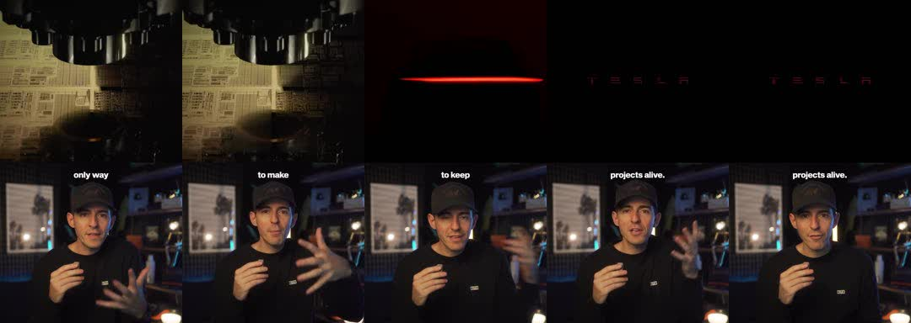

# v05_s23 · split_broll · 43.8–48.0s (calidad 3)

- **Guion:** way for him to make enough chips to keep his current projects alive.
- **Qué se ve:** Arriba: macro de litografía sobre una oblea dorada con un haz de luz (43.84–45.92), silueta roja de un Tesla con la luz trasera (45.92–46.4, parpadea) y negro con el logotipo «TESLA» en rojo tenue (46.4–48.05).
- **Diseño:** Subtítulo blanco sans bold (tipo Inter/Helvetica Now), minúsculas con mayúscula inicial, 1–3 palabras, ~28 px sobre 720 (≈2,2 % del alto), centrado en x, y≈54 % (justo bajo la costura, que está en y≈50,4 %); sin caja sobre el A-roll oscuro
- **Efectos:** Parpadeo rojo/negro propio del teaser de Tesla (45.92–46.3)
- **Animación:** Corte seco de entrada y salida (1 fotograma)
- **Por qué aquí:** «Make enough chips» → se ve cómo se graban; «keep his current projects alive» → producto Tesla. El negro final deja respirar
