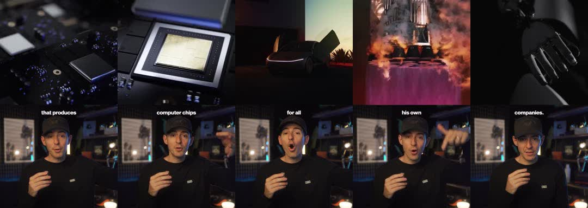

# v05_s26 · split_broll · 52.1–55.7s (calidad 4)

- **Guion:** produces computer chips for all of his own companies. And
- **Qué se ve:** Arriba, montaje de 5 planos: chips sobre placa (52.14–52.72), disipador/chip plateado (52.72–53.0), chip dorado (53.0–53.64), coche Tesla al atardecer (53.64–54.30), motores de cohete con fuego (54.30–55.01), mano de robot (55.01–55.72).
- **Diseño:** Subtítulo blanco sans bold (tipo Inter/Helvetica Now), minúsculas con mayúscula inicial, 1–3 palabras, ~28 px sobre 720 (≈2,2 % del alto), centrado en x, y≈54 % (justo bajo la costura, que está en y≈50,4 %); sin caja sobre el A-roll oscuro
- **Efectos:** Set oscuro con luces prácticas cian y ámbar desenfocadas; sin textura añadida visible
- **Animación:** Corte seco de entrada y salida (1 fotograma)
- **Por qué aquí:** «Computer chips for all of his own companies»: chips y después una imagen por empresa, repitiendo el recurso de la lista pero dentro de la mitad superior
