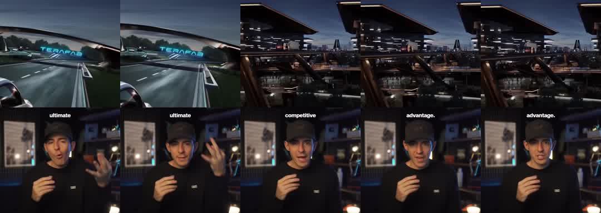

# v05_s28 · split_broll · 57.5–59.1s (calidad 2)

- **Guion:** competitive advantage.
- **Qué se ve:** Arriba: render de la carretera con el rótulo «TERAFAB» (57.47–58.06) y render nocturno de la estructura (58.06–59.14).
- **Diseño:** Subtítulo blanco sans bold (tipo Inter/Helvetica Now), minúsculas con mayúscula inicial, 1–3 palabras, ~28 px sobre 720 (≈2,2 % del alto), centrado en x, y≈54 % (justo bajo la costura, que está en y≈50,4 %); sin caja sobre el A-roll oscuro
- **Efectos:** Set oscuro con luces prácticas cian y ámbar desenfocadas; sin textura añadida visible
- **Animación:** Corte seco de entrada y salida (1 fotograma)
- **Por qué aquí:** «Ultimate competitive advantage»: imágenes aspiracionales del complejo
