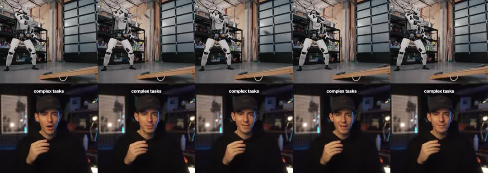

# v06_s12 · split_broll · 13.6–14.5s (calidad 3)

- **Guion:** tasks is
- **Qué se ve:** Arriba: robot humanoide blanco lanzando en un garaje con un tablero de cornhole.
- **Diseño:** Subtítulo blanco sans bold (tipo Inter), 1–3 palabras, ~30 px sobre 720 (≈2,3 % del alto), centrado, y≈52,7 % (≈58 px bajo la costura, que está en y≈48,1 %); sin caja
- **Efectos:** Set oscuro con luces cian y ámbar desenfocadas; sin textura añadida
- **Animación:** Corte seco de entrada y salida (1 fotograma)
- **Por qué aquí:** «Complex tasks» → robot real ejecutando la tarea
