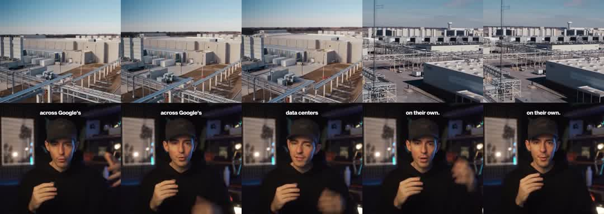

# v06_s35 · split_broll · 62.0–64.0s (calidad 3)

- **Guion:** Google's data centers on their own.
- **Qué se ve:** Arriba: vista aérea de un centro de datos (2 planos, corte a 63.47).
- **Diseño:** Subtítulo blanco sans bold (tipo Inter), 1–3 palabras, ~30 px sobre 720 (≈2,3 % del alto), centrado, y≈52,7 % (≈58 px bajo la costura, que está en y≈48,1 %); sin caja
- **Efectos:** Set oscuro con luces cian y ámbar desenfocadas; sin textura añadida
- **Animación:** Corte seco de entrada y salida (1 fotograma)
- **Por qué aquí:** «Across Google's data centers» → literal
