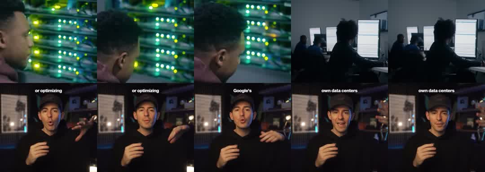

# v06_s40 · split_broll · 73.3–75.9s (calidad 2)

- **Guion:** optimizing Google's own data centers,
- **Qué se ve:** Arriba: una persona frente a un rack con LEDs verdes (73.30–74.90) y personas a contraluz ante monitores (74.90–75.93).
- **Diseño:** Subtítulo blanco sans bold (tipo Inter), 1–3 palabras, ~30 px sobre 720 (≈2,3 % del alto), centrado, y≈52,7 % (≈58 px bajo la costura, que está en y≈48,1 %); sin caja
- **Efectos:** Set oscuro con luces cian y ámbar desenfocadas; sin textura añadida
- **Animación:** Corte seco de entrada y salida (1 fotograma)
- **Por qué aquí:** «Or optimizing Google's own data centers» → literal
