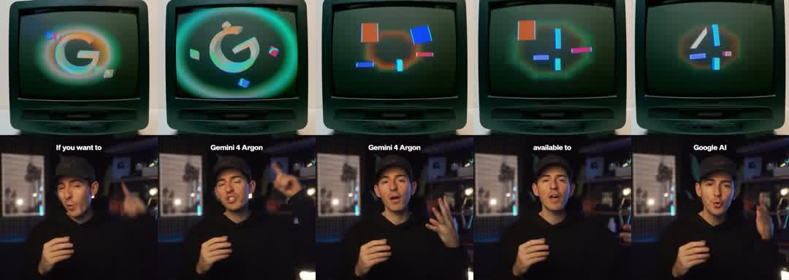

# v06_s42 · split_broll · 78.3–81.3s (calidad 4)

- **Guion:** If you want to try it out, Gemini 4 Argonne is now available to Google AI
- **Qué se ve:** Arriba: el televisor CRT del inicio mostrando una animación de la «G» de Google que se descompone en piezas de colores y forma un «4».
- **Diseño:** Subtítulo blanco sans bold (tipo Inter), 1–3 palabras, ~30 px sobre 720 (≈2,3 % del alto), centrado, y≈52,7 % (≈58 px bajo la costura, que está en y≈48,1 %); sin caja
- **Efectos:** Curvatura y brillo de pantalla CRT
- **Animación:** Corte seco de entrada y salida (1 fotograma)
- **Por qué aquí:** «If you want to try it out» → vuelve el motivo visual del primer fotograma (cierra el círculo)
