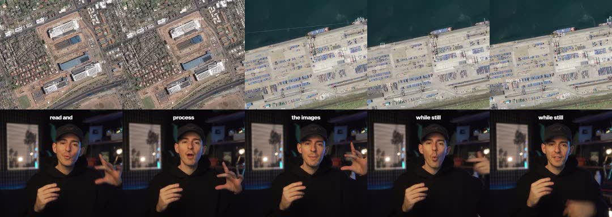

# v07_s14 · split_broll · 21.8–23.9s (calidad 3)

- **Guion:** read and process the images while still
- **Qué se ve:** Arriba: imágenes satelitales de una zona industrial (21.81–22.69) y de un puerto con contenedores donde aparecen números (22.69–23.94).
- **Diseño:** Subtítulo blanco sans bold (tipo Inter), 1–3 palabras, ~28 px sobre 720, centrado, y≈54 % (≈48 px bajo la costura, que está en y≈50,4 %); sin caja sobre el A-roll
- **Efectos:** Set oscuro con luces cian y ámbar desenfocadas; sin textura añadida
- **Animación:** Corte seco de entrada y salida (1 fotograma)
- **Por qué aquí:** «Read and process the images» → imágenes reales con lectura automática
