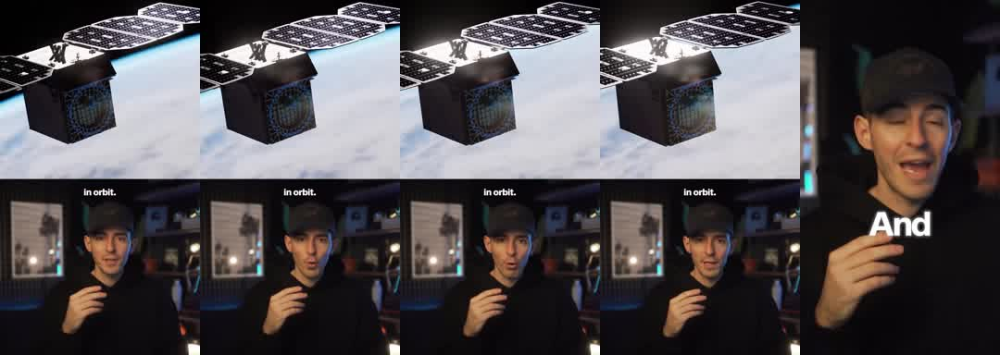

# v07_s15 · split_broll · 23.9–24.6s (calidad 2)

- **Guion:** in orbit.
- **Qué se ve:** Arriba: el satélite negro sobre nubes (mismo render del inicio).
- **Diseño:** Subtítulo blanco sans bold (tipo Inter), 1–3 palabras, ~28 px sobre 720, centrado, y≈54 % (≈48 px bajo la costura, que está en y≈50,4 %); sin caja sobre el A-roll
- **Efectos:** Set oscuro con luces cian y ámbar desenfocadas; sin textura añadida
- **Animación:** Corte seco de entrada y salida (1 fotograma)
- **Por qué aquí:** «In orbit» → el satélite en órbita
