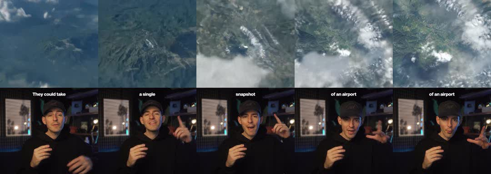

# v07_s18 · split_broll · 27.0–29.3s (calidad 4)

- **Guion:** could take a single snapshot of an airport and
- **Qué se ve:** Arriba: zoom continuo desde las nubes hasta el terreno.
- **Diseño:** Subtítulo blanco sans bold (tipo Inter), 1–3 palabras, ~28 px sobre 720, centrado, y≈54 % (≈48 px bajo la costura, que está en y≈50,4 %); sin caja sobre el A-roll
- **Efectos:** Desenfoque de movimiento en el zoom
- **Animación:** Corte seco; push-in continuo 2,3 s
- **Por qué aquí:** «Take a single snapshot of an airport» → el viaje de la cámara hasta el objetivo
