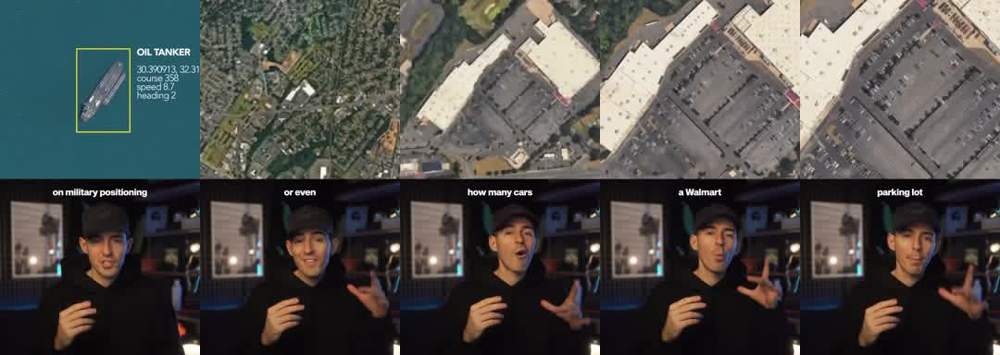

# v07_s22 · split_broll · 35.9–38.4s (calidad 4)

- **Guion:** or even how many cars are in a Walmart parking
- **Qué se ve:** Arriba: zoom continuo desde una región hasta el tejado de un Walmart y su aparcamiento.
- **Diseño:** Subtítulo blanco sans bold (tipo Inter), 1–3 palabras, ~28 px sobre 720, centrado, y≈54 % (≈48 px bajo la costura, que está en y≈50,4 %); sin caja sobre el A-roll
- **Efectos:** Desenfoque de movimiento
- **Animación:** Corte seco a 35.9; push-in continuo 2,5 s
- **Por qué aquí:** «How many cars are in a Walmart parking lot» → viaje hasta el aparcamiento
