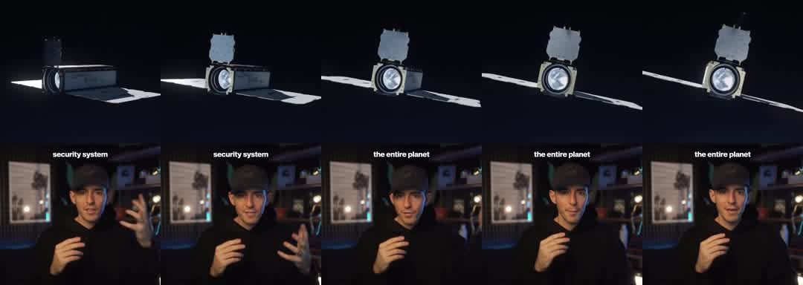

# v07_s34 · split_broll · 61.2–63.3s (calidad 3)

- **Guion:** security system for the entire planet.
- **Qué se ve:** Arriba: lente del satélite con paneles en la oscuridad, acercándose.
- **Diseño:** Subtítulo blanco sans bold (tipo Inter), 1–3 palabras, ~28 px sobre 720, centrado, y≈54 % (≈48 px bajo la costura, que está en y≈50,4 %); sin caja sobre el A-roll
- **Efectos:** Set oscuro con luces cian y ámbar desenfocadas; sin textura añadida
- **Animación:** Corte seco de entrada y salida (1 fotograma)
- **Por qué aquí:** «Security system for the entire planet» → ojo/lente como metáfora de vigilancia
