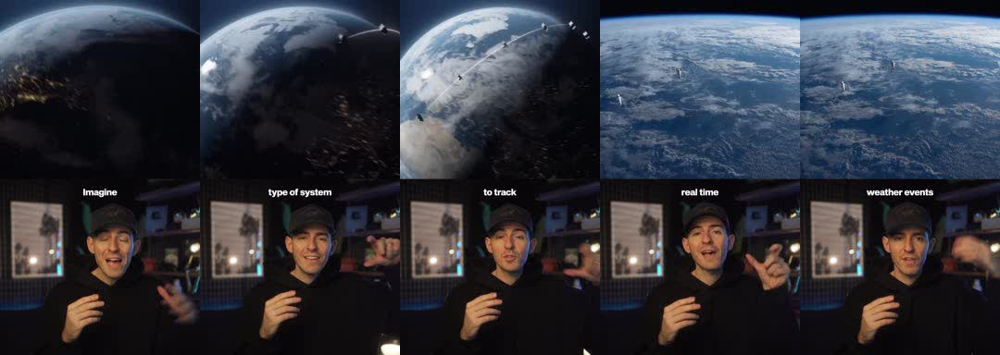

# v07_s36 · split_broll · 67.5–70.5s (calidad 3)

- **Guion:** Imagine using this type of system to track real -time weather events
- **Qué se ve:** Arriba: la Tierra de noche con una constelación de satélites (67.48–69.32) y superficie nubosa desde la órbita (69.32–70.53).
- **Diseño:** Subtítulo blanco sans bold (tipo Inter), 1–3 palabras, ~28 px sobre 720, centrado, y≈54 % (≈48 px bajo la costura, que está en y≈50,4 %); sin caja sobre el A-roll
- **Efectos:** Set oscuro con luces cian y ámbar desenfocadas; sin textura añadida
- **Animación:** Corte seco de entrada y salida (1 fotograma)
- **Por qué aquí:** «Imagine using this type of system» → visión aspiracional
