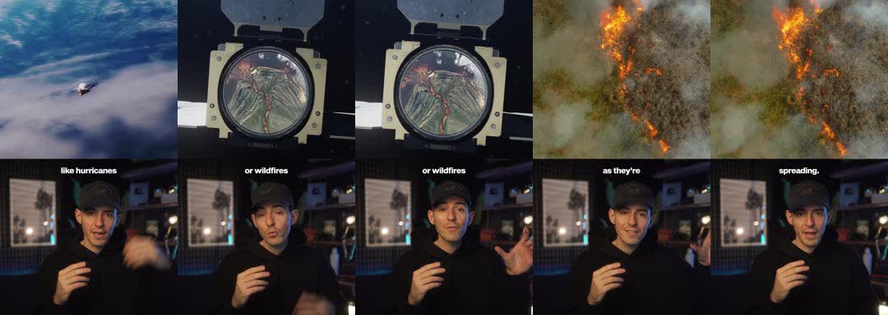

# v07_s37 · split_broll · 70.5–73.5s (calidad 4)

- **Guion:** like hurricanes or wildfires as they're spreading.
- **Qué se ve:** Arriba: satélite sobre un sistema de nubes (70.53–71.20), lente que refleja un mapa de incendio (71.20–72.41) e incendio forestal visto desde arriba (72.41–73.49).
- **Diseño:** Subtítulo blanco sans bold (tipo Inter), 1–3 palabras, ~28 px sobre 720, centrado, y≈54 % (≈48 px bajo la costura, que está en y≈50,4 %); sin caja sobre el A-roll
- **Efectos:** Naranja de fuego sobre humo gris en el último plano
- **Animación:** Corte seco de entrada y salida (1 fotograma)
- **Por qué aquí:** «Hurricanes or wildfires as they're spreading» → un plano por ejemplo
