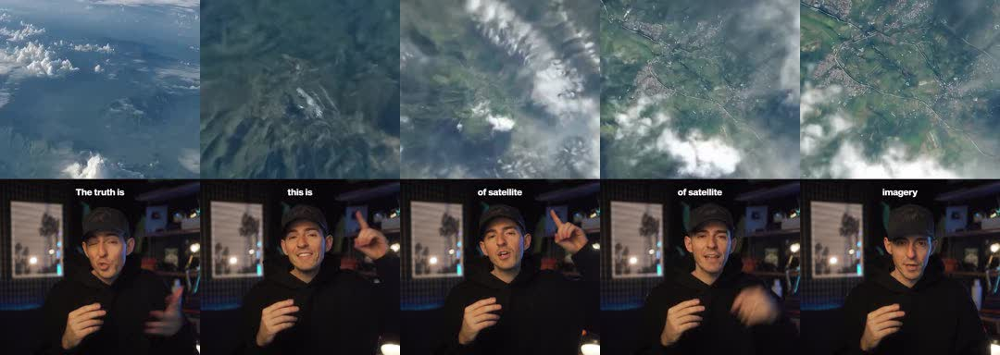

# v07_s38 · split_broll · 73.5–75.9s (calidad 3)

- **Guion:** The truth is, this is the future of satellite imagery.
- **Qué se ve:** Arriba: zoom continuo a través de nubes hasta un valle con pueblos.
- **Diseño:** Subtítulo blanco sans bold (tipo Inter), 1–3 palabras, ~28 px sobre 720, centrado, y≈54 % (≈48 px bajo la costura, que está en y≈50,4 %); sin caja sobre el A-roll
- **Efectos:** Desenfoque de movimiento
- **Animación:** Corte seco de entrada y salida (1 fotograma)
- **Por qué aquí:** «The future of satellite imagery» → repite el motivo del zoom
