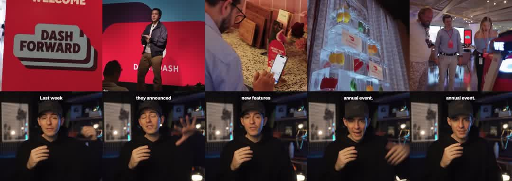

# v08_s04 · split_broll · 7.5–10.7s (calidad 4)

- **Guion:** Last week, they announced a ton of new features at their annual event.
- **Qué se ve:** Pantalla dividida. Arriba, 7 planos del evento en 3,3 s: cartel «WELCOME · DASH FORWARD» (7.47–7.92), presentador en escenario rojo (7.92–8.38), hombre con móvil y burbujas de chat (8.38–8.93), manos con móvil en un mostrador (8.93–9.47), escultura de hielo «DOORDASH Reservations» (9.47–9.84), barra de hielo (9.84–10.26) y asistentes (10.26–10.72).
- **Diseño:** Subtítulo blanco sans bold (tipo Inter), 1–3 palabras, ~28 px sobre 720, centrado, y≈54 % (≈48 px bajo la costura, que está en y≈50,4 %); sin caja
- **Efectos:** Set oscuro con luces cian y ámbar desenfocadas; sin textura añadida
- **Animación:** Corte seco de entrada y salida (1 fotograma)
- **Por qué aquí:** «They announced a ton of new features» → «a ton» = muchos planos muy cortos
