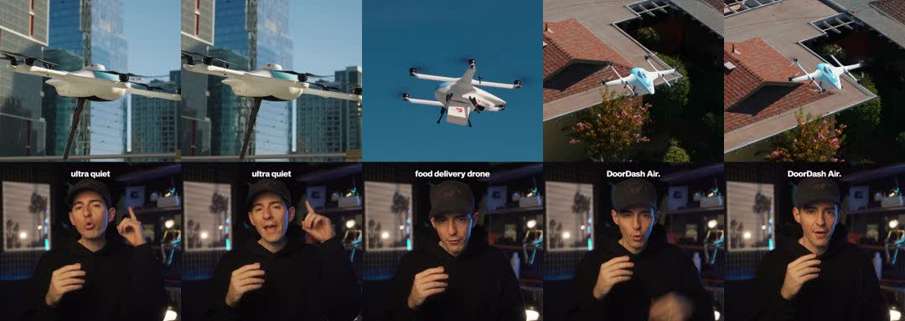

# v08_s06 · split_broll · 12.1–14.9s (calidad 3)

- **Guion:** quiet food delivery drone DoorDash Air.
- **Qué se ve:** Arriba: dron en su soporte frente a edificios de cristal (12.05–12.97), dron volando en cielo azul con caja DoorDash (12.97–14.14) y dron sobre tejados (14.14–14.89).
- **Diseño:** Subtítulo blanco sans bold (tipo Inter), 1–3 palabras, ~28 px sobre 720, centrado, y≈54 % (≈48 px bajo la costura, que está en y≈50,4 %); sin caja
- **Efectos:** Set oscuro con luces cian y ámbar desenfocadas; sin textura añadida
- **Animación:** Corte seco de entrada y salida (1 fotograma)
- **Por qué aquí:** «Ultra quiet food delivery drone, DoorDash Air» → presentación del producto desde 3 ángulos
