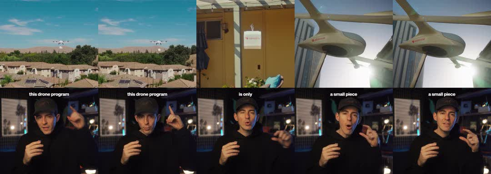

# v08_s10 · split_broll · 21.9–24.4s (calidad 3)

- **Guion:** drone program is only a small piece of
- **Qué se ve:** Arriba: dron sobre un vecindario (21.94–22.65), caja bajando con cable junto a una casa amarilla (22.65–23.36) y dron en contrapicado (23.36–24.40).
- **Diseño:** Subtítulo blanco sans bold (tipo Inter), 1–3 palabras, ~28 px sobre 720, centrado, y≈54 % (≈48 px bajo la costura, que está en y≈50,4 %); sin caja
- **Efectos:** Set oscuro con luces cian y ámbar desenfocadas; sin textura añadida
- **Animación:** Corte seco de entrada y salida (1 fotograma)
- **Por qué aquí:** «This drone program is only a small piece» → el dron una vez más antes de dejarlo atrás
