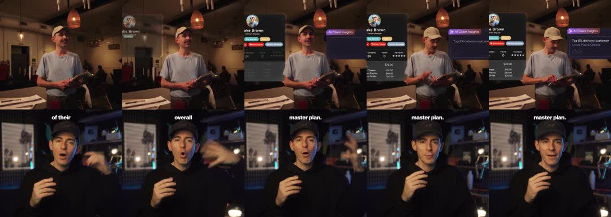

# v08_s11 · split_broll · 24.4–26.3s (calidad 3)

- **Guion:** their overall master plan.
- **Qué se ve:** Arriba: hombre con una tableta en un restaurante; aparecen paneles flotantes de interfaz (perfil de cliente «Jake Brown», «AI Client Insights»).
- **Diseño:** Subtítulo blanco sans bold (tipo Inter), 1–3 palabras, ~28 px sobre 720, centrado, y≈54 % (≈48 px bajo la costura, que está en y≈50,4 %); sin caja
- **Efectos:** Set oscuro con luces cian y ámbar desenfocadas; sin textura añadida
- **Animación:** Corte seco; paneles aparecen con fundido (≈24.8 y ≈25.3)
- **Por qué aquí:** «Their overall master plan» → otra pieza del plan (software para restaurantes)
