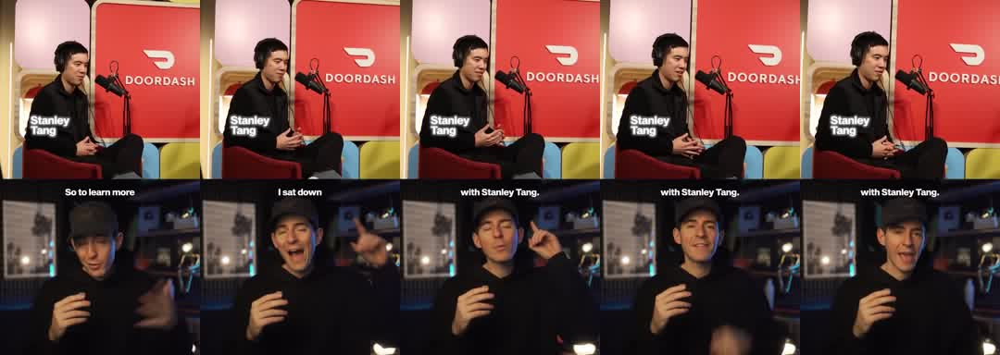

# v08_s12 · split_broll · 26.3–28.3s (calidad 4)

- **Guion:** So to learn more, I sat down with Stanley Tang,
- **Qué se ve:** Arriba: Stanley Tang en un set de pódcast con fondo rojo DoorDash y micrófono; rótulo «Stanley Tang» junto a él.
- **Diseño:** Rótulo «Stanley / Tang» en 2 líneas, sans bold blanca ~34 px con sombra/glow oscuro, a la izquierda sobre su pecho. Subtítulo blanco sans bold (tipo Inter), 1–3 palabras, ~28 px sobre 720, centrado, y≈54 % (≈48 px bajo la costura, que está en y≈50,4 %); sin caja
- **Efectos:** Set oscuro con luces cian y ámbar desenfocadas; sin textura añadida
- **Animación:** Corte seco; el rótulo está desde el primer fotograma
- **Por qué aquí:** «I sat down with Stanley Tang» → presenta al invitado con nombre en pantalla
