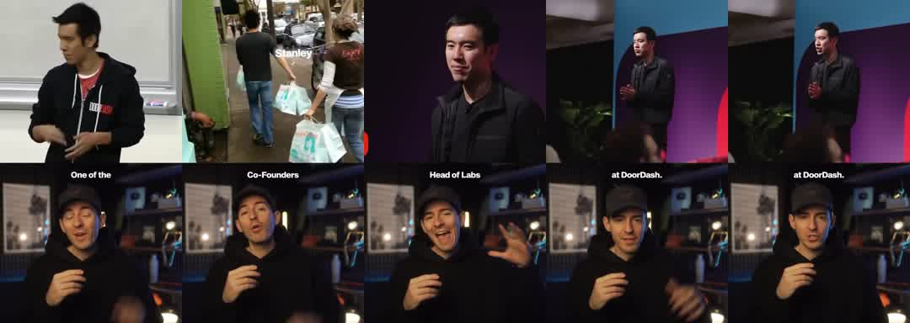

# v08_s13 · split_broll · 28.3–31.5s (calidad 4)

- **Guion:** one of the original co -founders and head of labs at DoorDash.
- **Qué se ve:** Arriba, 4 imágenes de archivo de Stanley: joven con sudadera (28.28–28.99), foto de espaldas cargando bolsas con la etiqueta «Stanley» y una flecha curva (28.99–29.90), retrato sobre fondo morado (29.90–30.66) y en un escenario (30.66–31.49).
- **Diseño:** Etiqueta «Stanley» en sans bold blanca con flecha curva blanca dibujada. Subtítulo blanco sans bold (tipo Inter), 1–3 palabras, ~28 px sobre 720, centrado, y≈54 % (≈48 px bajo la costura, que está en y≈50,4 %); sin caja
- **Efectos:** Set oscuro con luces cian y ámbar desenfocadas; sin textura añadida
- **Animación:** Corte seco de entrada y salida (1 fotograma)
- **Por qué aquí:** «One of the original co-founders and head of Labs» → credenciales con fotos de época
