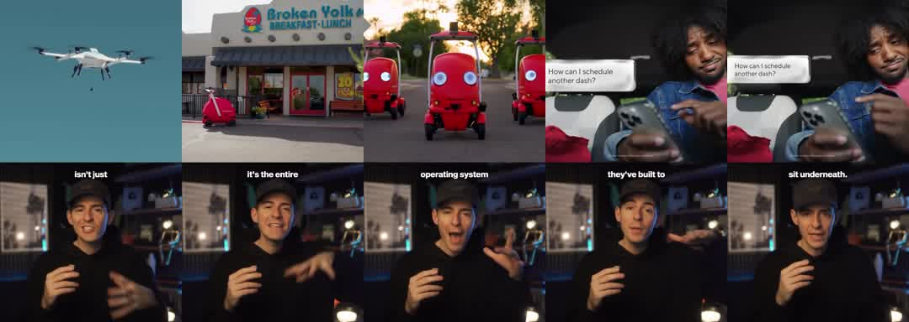

# v08_s23 · split_broll · 54.1–59.9s (calidad 3)

- **Guion:** just the drones, it's the entire delivery operating system layer they've built to sit underneath.
- **Qué se ve:** Arriba: dron en el cielo (54.14–55.39), robot Dot frente al restaurante «Broken Yolk» (55.39–56.39), pantalla partida mapa + robot (56.39–56.97), cuatro robots Dot de frente (56.97–58.10) y hombre con móvil y burbuja «How can I schedule another dash?» (58.10–59.85).
- **Diseño:** Subtítulo blanco sans bold (tipo Inter), 1–3 palabras, ~28 px sobre 720, centrado, y≈54 % (≈48 px bajo la costura, que está en y≈50,4 %); sin caja
- **Efectos:** Set oscuro con luces cian y ámbar desenfocadas; sin textura añadida
- **Animación:** Corte seco de entrada y salida (1 fotograma)
- **Por qué aquí:** «Isn't just the drones, it's the entire delivery operating system» → pasa del dron a todo lo demás
