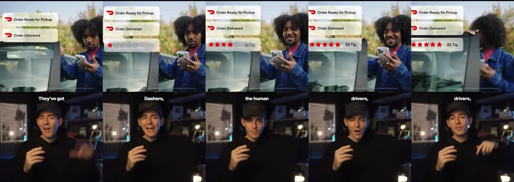

# v08_s25 · split_broll · 63.2–65.0s (calidad 4)

- **Guion:** They've got dashers, the human drivers,
- **Qué se ve:** Arriba: hombre con móvil junto a un coche; a la izquierda se apilan tarjetas de notificación «Order Ready for Pickup», «Order Delivered» y «★★★★★ $5 Tip».
- **Diseño:** Tarjetas blancas translúcidas redondeadas con logo rojo y texto sans oscuro; estrellas rojas. Subtítulo blanco sans bold (tipo Inter), 1–3 palabras, ~28 px sobre 720, centrado, y≈54 % (≈48 px bajo la costura, que está en y≈50,4 %); sin caja
- **Efectos:** Set oscuro con luces cian y ámbar desenfocadas; sin textura añadida
- **Animación:** Corte seco; tarjetas aparecen a ≈63.2, 63.3 y 63.6; estrellas de 1 a 5 en ≈0,8 s
- **Por qué aquí:** Lista 1/3: «Dashers, the human drivers» → humano + notificaciones
