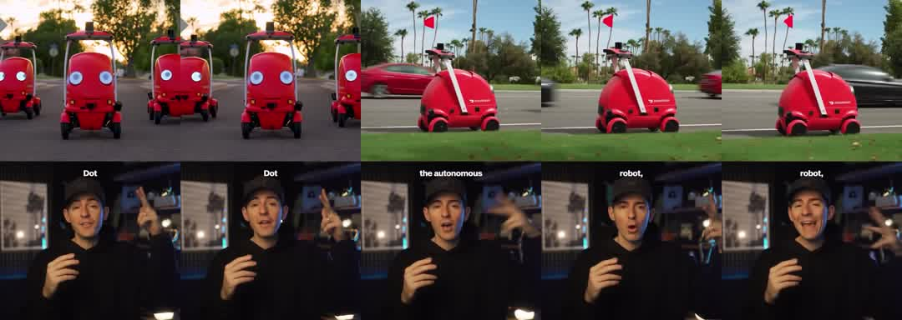

# v08_s26 · split_broll · 65.0–66.7s (calidad 4)

- **Guion:** dot, the autonomous robot,
- **Qué se ve:** Arriba: robots Dot rojos de frente (64.98–65.57) y un Dot junto a la carretera con coches pasando (65.57–66.65).
- **Diseño:** Subtítulo blanco sans bold (tipo Inter), 1–3 palabras, ~28 px sobre 720, centrado, y≈54 % (≈48 px bajo la costura, que está en y≈50,4 %); sin caja
- **Efectos:** Set oscuro con luces cian y ámbar desenfocadas; sin textura añadida
- **Animación:** Corte seco de entrada y salida (1 fotograma)
- **Por qué aquí:** Lista 2/3: «Dot, the autonomous robot»
