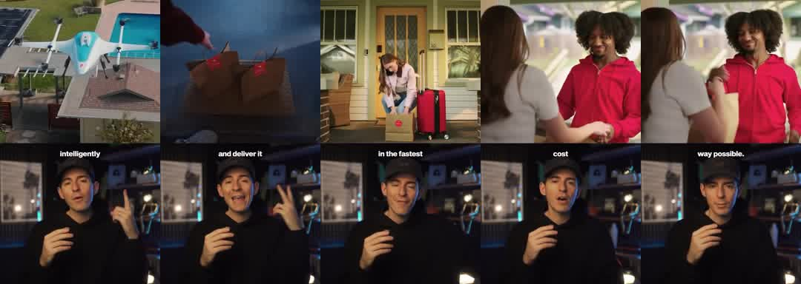

# v08_s29 · split_broll · 70.0–74.8s (calidad 3)

- **Guion:** route and deliver it in the fastest and most cost efficient way possible.
- **Qué se ve:** Arriba: dron sobre un tejado con piscina (69.99–71.20), bolsas de papel con logo (71.20–72.07), mujer recogiendo una bolsa en su puerta (72.07–73.07) y repartidor con sudadera roja entregando una bolsa (73.07–74.82).
- **Diseño:** Subtítulo blanco sans bold (tipo Inter), 1–3 palabras, ~28 px sobre 720, centrado, y≈54 % (≈48 px bajo la costura, que está en y≈50,4 %); sin caja
- **Efectos:** Set oscuro con luces cian y ámbar desenfocadas; sin textura añadida
- **Animación:** Corte seco de entrada y salida (1 fotograma)
- **Por qué aquí:** «Intelligently route and deliver it in the fastest and most cost efficient way» → entrega completada por distintas vías
