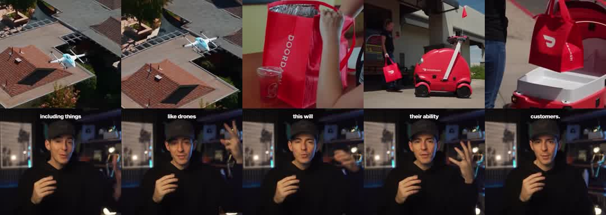

# v08_s31 · split_broll · 77.0–82.1s (calidad 3)

- **Guion:** things like drones and autonomous vehicles, this will increase their ability to serve customers.
- **Qué se ve:** Arriba: dron sobre tejados (76.95–78.33), robots Dot ante «Broken Yolk» (78.33–79.37), bolsa roja DoorDash (79.37–80.29), persona junto a un Dot (80.29–81.08) y bolsa entrando en el compartimento del robot (81.08–82.08).
- **Diseño:** Subtítulo blanco sans bold (tipo Inter), 1–3 palabras, ~28 px sobre 720, centrado, y≈54 % (≈48 px bajo la costura, que está en y≈50,4 %); sin caja
- **Efectos:** Set oscuro con luces cian y ámbar desenfocadas; sin textura añadida
- **Animación:** Corte seco de entrada y salida (1 fotograma)
- **Por qué aquí:** «Including things like drones and autonomous vehicles… serve customers» → un plano por sustantivo
