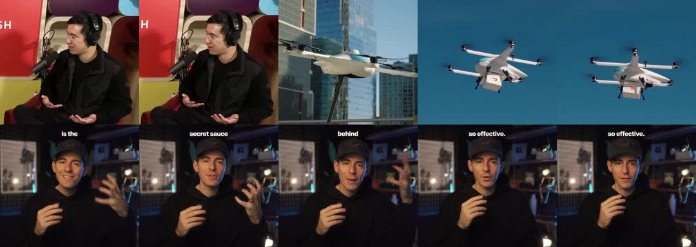

# v08_s33 · split_broll · 83.6–86.2s (calidad 3)

- **Guion:** the secret sauce behind why they're so effective.
- **Qué se ve:** Arriba: Stanley en el set de pódcast (83.63–84.79), dron en su soporte (84.79–85.38) y dron en cielo azul (85.38–86.25).
- **Diseño:** Subtítulo blanco sans bold (tipo Inter), 1–3 palabras, ~28 px sobre 720, centrado, y≈54 % (≈48 px bajo la costura, que está en y≈50,4 %); sin caja
- **Efectos:** Set oscuro con luces cian y ámbar desenfocadas; sin textura añadida
- **Animación:** Corte seco de entrada y salida (1 fotograma)
- **Por qué aquí:** «The secret sauce behind why they're so effective» → vuelve el autor de la idea y el producto
