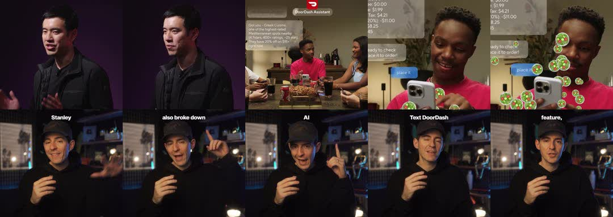

# v08_s34 · split_broll · 86.2–89.9s (calidad 3)

- **Guion:** Stanley also broke down how they're using AI in the new Text DoorDash feature,
- **Qué se ve:** Arriba: retrato de Stanley sobre morado (86.25–87.92), grupo en una mesa con un panel «DoorDash Assistant» (87.92–88.46) y hombre con móvil, burbujas de chat («place it») y emojis verdes flotando (88.46–89.92).
- **Diseño:** Subtítulo blanco sans bold (tipo Inter), 1–3 palabras, ~28 px sobre 720, centrado, y≈54 % (≈48 px bajo la costura, que está en y≈50,4 %); sin caja
- **Efectos:** Set oscuro con luces cian y ámbar desenfocadas; sin textura añadida
- **Animación:** Corte seco de entrada y salida (1 fotograma)
- **Por qué aquí:** «How they're using AI in the new Text DoorDash feature» → chat por texto
