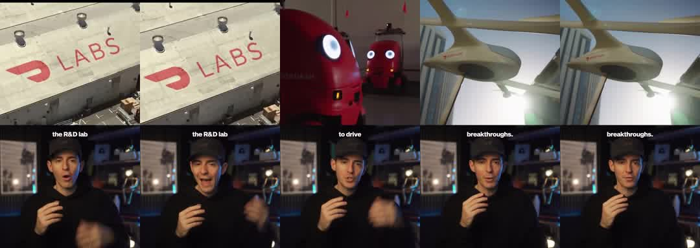

# v08_s36 · split_broll · 91.3–93.6s (calidad 3)

- **Guion:** R &D lab to drive new breakthroughs.
- **Qué se ve:** Arriba: tejado «LABS» (91.30–92.30), primer plano de un Dot con el «ojo» encendido (92.30–92.80) y parte inferior del dron (92.80–93.59).
- **Diseño:** Subtítulo blanco sans bold (tipo Inter), 1–3 palabras, ~28 px sobre 720, centrado, y≈54 % (≈48 px bajo la costura, que está en y≈50,4 %); sin caja
- **Efectos:** Set oscuro con luces cian y ámbar desenfocadas; sin textura añadida
- **Animación:** Corte seco de entrada y salida (1 fotograma)
- **Por qué aquí:** «The R&D lab to drive new breakthroughs» → laboratorio + sus dos inventos
