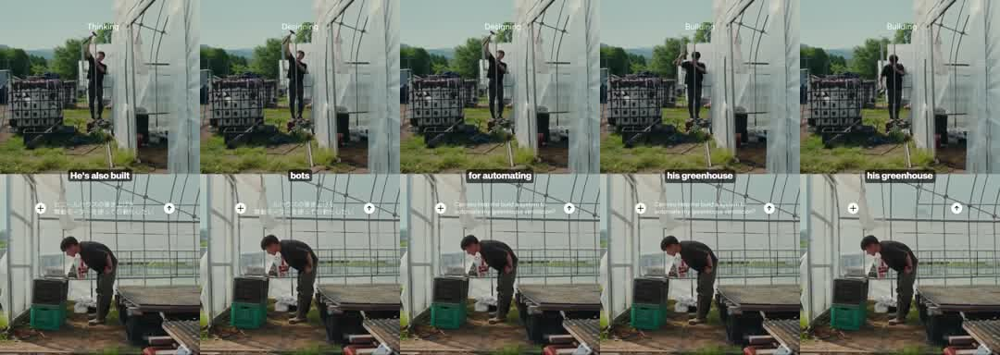

# v09_s15 · split_broll · 31.5–34.0s (calidad 5)

- **Guion:** He's also built bots for automating his greenhouse,
- **Qué se ve:** Split SIN él: dos b-rolls apilados. Arriba Hiroki subido a la estructura del invernadero (rótulo tenue 'Designing/Building' del material original); abajo Hiroki agachado con una barra de prompt superpuesta: 'Can you help me build a system to automate my greenhouse ventilation?'.
- **Diseño:** Pantalla 50/50 sin Kallaway: dos vídeos a sangre apilados. Sobre el inferior, barra de prompt estilo ChatGPT (texto blanco fino ≈18 px, icono '+' en círculo blanco a la izquierda y '↑' a la derecha, y≈57–60 %). Subtítulo blanco bold con caja gris translúcida justo sobre la costura (y≈49 %).
- **Efectos:** Sin grano, papel ni halftone añadidos. A-roll: set oscuro, viñeta natural, prácticos cálidos y tubo/luz cian al fondo. Mitad superior sin filtros: el material conserva su color original (contraste fuerte con el set oscuro de abajo).
- **Animación:** La mitad superior entra por corte seco (1 fotograma) sincronizada con la palabra; los cambios internos también son cortes secos; el único movimiento es el propio del material (cámara del clip, scroll o zoom lento). La mitad inferior no corta (toma continua). Subtítulo por sustitución instantánea cada 1–3 palabras.
- **Por qué aquí:** Lista de inventos ('bots for automating his greenhouse'): sustituye su cara por la escena + el prompt real que lo originó → enseña CÓMO se pide.
