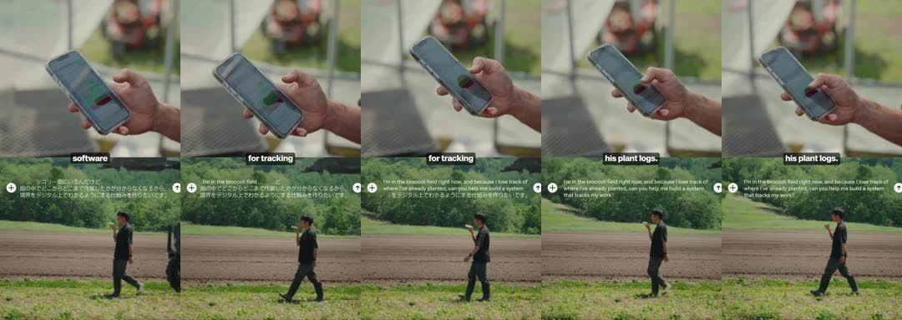

# v09_s16 · split_broll · 34.0–36.1s (calidad 4)

- **Guion:** software for tracking his plant logs.
- **Qué se ve:** Split SIN él: arriba móvil en la mano; abajo Hiroki caminando por el campo con prompt superpuesto bilingüe (japonés + 'I'm in the broccoli field right now… can you help me build a system that tracks my work?').
- **Diseño:** Pantalla 50/50 sin Kallaway: dos vídeos a sangre apilados; prompt en texto blanco fino (≈16 px) en 3 líneas con '+' y '↑' en y≈53–58 %. Subtítulo bold con caja translúcida sobre la costura.
- **Efectos:** Sin grano, papel ni halftone añadidos. A-roll: set oscuro, viñeta natural, prácticos cálidos y tubo/luz cian al fondo. Mitad superior sin filtros: el material conserva su color original (contraste fuerte con el set oscuro de abajo).
- **Animación:** La mitad superior entra por corte seco (1 fotograma) sincronizada con la palabra; los cambios internos también son cortes secos; el único movimiento es el propio del material (cámara del clip, scroll o zoom lento). La mitad inferior no corta (toma continua). Subtítulo por sustitución instantánea cada 1–3 palabras.
- **Por qué aquí:** Segundo ítem de la lista ('software for tracking his plant logs') con el mismo patrón → ritmo de enumeración.
