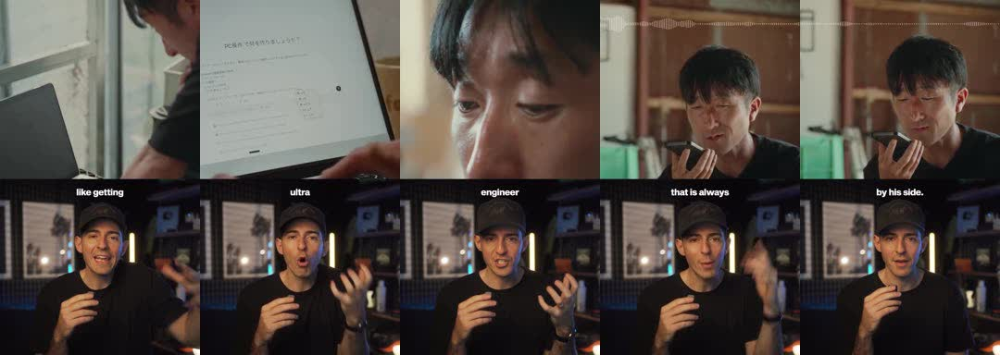

# v09_s24 · split_broll · 47.1–51.2s (calidad 3)

- **Guion:** getting access to an ultra-talented engineer that is always by his side.
- **Qué se ve:** Arriba 4 clips: borde del portátil, pantalla, ojos en primerísimo plano y Hiroki hablando al móvil con una onda de audio superpuesta.
- **Diseño:** Split 50/50: vídeo real a sangre arriba (recorte horizontal ≈9:8), él abajo en plano medio sobre set oscuro con luces cálidas/cian. Subtítulo: sans geométrica bold blanca, minúsculas con puntuación, ≈30 px de alto de letra sobre 720 px de ancho, centrado en x, 1–3 palabras, bajo la costura (y≈54 %), sin caja.
- **Efectos:** Sin grano, papel ni halftone añadidos. A-roll: set oscuro, viñeta natural, prácticos cálidos y tubo/luz cian al fondo. Mitad superior sin filtros: el material conserva su color original (contraste fuerte con el set oscuro de abajo).
- **Animación:** La mitad superior entra por corte seco (1 fotograma) sincronizada con la palabra; los cambios internos también son cortes secos; el único movimiento es el propio del material (cámara del clip, scroll o zoom lento). La mitad inferior no corta (toma continua). Subtítulo por sustitución instantánea cada 1–3 palabras.
- **Por qué aquí:** 'an ultra-talented engineer always by his side' → él hablando con el móvil = el ingeniero en el bolsillo.
