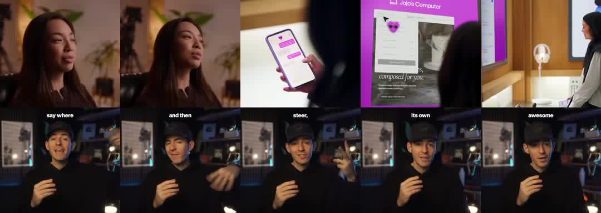

# v10_s26 · split_broll · 51.5–56.9s (calidad 3)

- **Guion:** say where you want to go, and then your dot can drive, steer, and fill up its own gas tank. It's pretty awesome.
- **Qué se ve:** Arriba 5 planos del film de lanzamiento: mujer de perfil, macro de chat con burbujas rosas, móvil en mano, web 'Wedding cakes' con mascota morada, mujer en la cocina.
- **Diseño:** Split 50/50: vídeo real a sangre arriba (recorte horizontal ≈9:8), él abajo en plano medio sobre set oscuro con luces cálidas/cian. Subtítulo: sans geométrica bold blanca, minúsculas con puntuación, ≈30 px de alto de letra sobre 720 px de ancho, centrado en x, 1–3 palabras, bajo la costura (y≈54 %), sin caja.
- **Efectos:** Sin grano, papel ni halftone añadidos. A-roll: set oscuro, viñeta natural, prácticos cálidos y tubo/luz cian al fondo. Mitad superior sin filtros: el material conserva su color original (contraste fuerte con el set oscuro de abajo).
- **Animación:** La mitad superior entra por corte seco (1 fotograma) sincronizada con la palabra; los cambios internos también son cortes secos; el único movimiento es el propio del material (cámara del clip, scroll o zoom lento). La mitad inferior no corta (toma continua). Subtítulo por sustitución instantánea cada 1–3 palabras.
- **Por qué aquí:** 'say where you want to go… your dot can drive, steer, fill its own gas tank': usuaria + agente trabajando solo.
