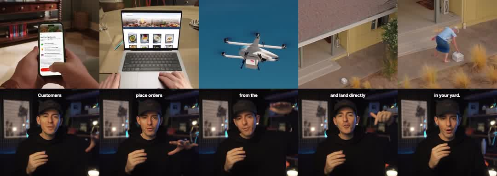

# v11_s05 · split_broll · 8.9–14.5s (calidad 4)

- **Guion:** Customers can out place orders that fly straight from the restaurant and land directly in your yard.
- **Qué se ve:** Arriba el recorrido del pedido en 6 clips: app en el móvil, portátil con la web del restaurante, caja con logo bajo el techo del local, dron en vuelo, dron bajando la caja junto a una casa, mujer recogiendo la caja en su jardín.
- **Diseño:** Split 50/50: vídeo real a sangre arriba (recorte horizontal ≈9:8), él abajo en plano medio sobre set oscuro con luces cálidas/cian. Subtítulo: sans geométrica bold blanca, minúsculas con puntuación, ≈30 px de alto de letra sobre 720 px de ancho, centrado en x, 1–3 palabras, bajo la costura (y≈54 %), sin caja.
- **Efectos:** Sin grano, papel ni halftone añadidos. A-roll: set oscuro, viñeta natural, prácticos cálidos y tubo/luz cian al fondo. Mitad superior sin filtros: el material conserva su color original (contraste fuerte con el set oscuro de abajo).
- **Animación:** La mitad superior entra por corte seco (1 fotograma) sincronizada con la palabra; los cambios internos también son cortes secos; el único movimiento es el propio del material (cámara del clip, scroll o zoom lento). La mitad inferior no corta (toma continua). Subtítulo por sustitución instantánea cada 1–3 palabras.
- **Por qué aquí:** Explica el proceso en orden cronológico: 'place orders' → 'fly straight from the restaurant' → 'land directly in your yard'; un clip por tramo de frase.
